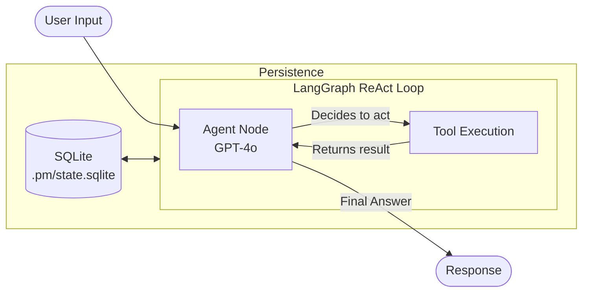
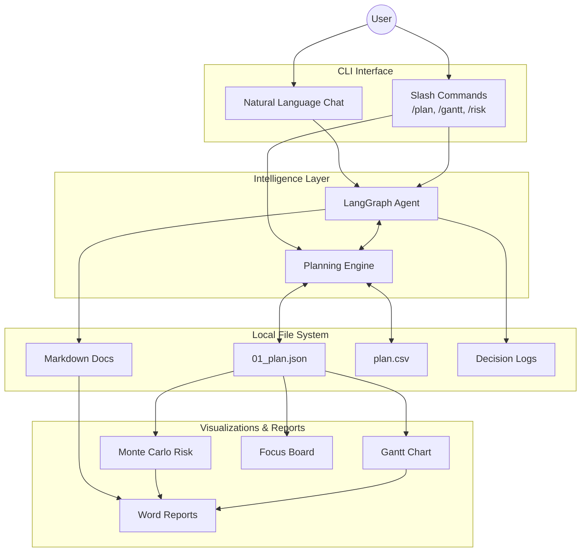

# PM Agent - CLI Project Manager

An intelligent CLI tool for managing projects using AI-powered automation with LangGraph and GPT-4.

## Features

- 🤖 AI-powered project management assistant
- 📋 Structured task tracking with JSON-based plans
- 📊 Automatic Gantt chart generation
- 💬 Interactive chat interface
- 📝 Decision logging and documentation
- 🔄 Persistent conversation memory


- Critical path and Monte Carlo risk insights
- Rolling /health dashboard with burndown/burnup, throughput, cycle-time percentiles, and plan-vs-actual histograms
- Rich task metadata (priority, effort, cost, risk, sprint/OKR, tags) powering smarter focus boards and workload balancing
- Near-term focus board, artifact vault, and instant documentation export
- Spreadsheet-friendly `plan.csv` mirror with slash command syncing
- Automatic decision log entries for every plan change

## Quick Install (TL;DR)

```bash
# Install UV
curl -LsSf https://astral.sh/uv/install.sh | sh  # macOS/Linux
# OR: powershell -c "irm https://astral.sh/uv/install.ps1 | iex"  # Windows

# Setup project
uv venv && source .venv/bin/activate  # macOS/Linux
# OR: uv venv && .venv\Scripts\activate  # Windows
uv pip install -e .

# Configure
cp .env.example .env  # Then add your GOOGLE_API_KEY (Gemini)

# Start using
pm new my-project
cd my-project-<timestamp-id>  # Folder name is <name>-<unique timestamp>. Use the ID printed after creation.
pm                    # Enter interactive mode
```

### Prefer Conda instead of UV?

```bash
# Create environment (Python 3.12 recommended)
conda create -n pm-agent python=3.12
conda activate pm-agent

# Install project in editable mode
pip install -e .

# Configure Gemini key
cp .env.example .env
# edit .env and set GOOGLE_API_KEY=your-key
```

All other usage instructions are the same once the environment is activated (`conda activate pm-agent`).
Each new workspace gets a timestamp-based ID, so a request like `pm new mobile-app` might create `mobile-app-20251119-070150`. The exact path is shown in the CLI output and saved to `.pm/project.json` alongside the name, ID, and creation time.

## Installation

### Prerequisites

**Install UV** (recommended - fast Python package manager):

```bash
# On macOS and Linux
curl -LsSf https://astral.sh/uv/install.sh | sh

# On Windows
powershell -c "irm https://astral.sh/uv/install.ps1 | iex"
```

Alternatively, you can use pip:
```bash
pip install uv
```

### Setup with UV (Recommended)

1. **Clone or navigate to this directory**

2. **Create a virtual environment and install dependencies**
```bash
# Create virtual environment
uv venv

# Activate the virtual environment
# On Windows:
.venv\Scripts\activate
# On macOS/Linux:
source .venv/bin/activate

# Install the package in editable mode with all dependencies
uv pip install -e .
```

3. **Configure Gemini API access**
```bash
# On macOS/Linux:
cp .env.example .env

# On Windows:
copy .env.example .env

# Edit .env and add your Google AI Studio key
# GOOGLE_API_KEY=your-gemini-api-key
# Optional overrides:
# GEMINI_MODEL=gemini-2.5-flash
```

### Alternative: Setup with pip

If you prefer using pip instead of UV:

```bash
# Create virtual environment
python -m venv .venv

# Activate it
# Windows: .venv\Scripts\activate
# macOS/Linux: source .venv/bin/activate

# Install dependencies
pip install -e .
```

## Quick Start

### 1. Start PM Agent
```bash
pm new my-project          # Creates my-project-<timestamp-id>
cd my-project-<timestamp-id>  # Use the actual folder name shown in CLI output
pm
```

You'll enter an interactive REPL where you can:
- **Chat naturally** with the AI: Just type your message
- **Use slash commands**: Type `/help` to see all commands

This creates a project with the following structure:
```
my-project/
├── 00_project_charter.md      # Goals, scope, stakeholders
├── 01_plan.json                # Task list (managed by agent)
├── 02_followups.json           # Action items
├── 03_risks_issues.md          # Risks and issues log
├── 04_decisions.log            # Decision journal (auto-logs plan updates)
├── 05_focus.json               # Near-term focus list snapshot
├── plan.csv                    # Spreadsheet-friendly mirror of 01_plan.json
├── gantt_latest.png            # Auto-generated timeline
├── artifacts/                  # Artifacts vault (analysis, documentation, inputs, exports)
└── .pm/                        # Agent memory (SQLite)
```

### Planned vs Actual Tracking

Each task stores both planned (`start_date`/`due_date`) and actual (`actual_start_date`/`actual_end_date`) dates. When you run `pm gantt --open`, the chart overlays the actual timeline (orange outline) on top of the baseline plan so you can immediately see over/under performance.

### 2. Inside PM Agent REPL

Once inside (after running `pm`), you can:

**Chat with the AI** (just type naturally):
```
> Let's plan a website redesign. We need to finish by end of month.

Agent: I'll help you plan this. Let me create some initial tasks...
```

**Use slash commands**:
```
> /status              # View task table
> /plan                # View the plan JSON
> /plan --edit         # Edit in your editor
> /gantt --open        # Generate and open Gantt chart
> /help                # Show all commands
> /exit                # Exit
```

### 3. Alternative: Direct Commands

You can also run commands directly without entering the REPL:
```bash
pm status        # Quick status check
pm gantt --open  # Generate and view chart
pm new my-project  # Create new project
```

## Commands Reference

### Interactive Mode (Recommended)
```bash
pm                    # Enter REPL (interactive mode)
pm mobile-app-launch  # Enter REPL in specific project
```

**Inside the REPL:**
- Just type naturally to chat with AI
- `/status` - Show task table
- `/status --week` - Get AI weekly summary
- `/plan` - View the plan JSON
- `/plan --edit` - Edit plan in editor
- `/plan --update-from-csv [path]` - Import plan edits from CSV (defaults to `plan.csv`)
- `/gantt` - Generate Gantt chart
- `/gantt --open` - Generate and open chart
- `/criticalpath` - Run critical path analysis
- `/risk --iterations 5000` - Monte Carlo schedule risk simulation
- `/forecast --deadline 2025-03-31 --cost-rate 800 --shock 5` - Advanced Monte Carlo (deadline probability, cost, dependency shocks)
- `/health --days 45` - Rolling burnup/throughput/cycle-time dashboard (exports charts + summary)
- `/workload --limit 12` - Prioritization + workload balancing (flags high-priority gaps, exports summary)
- `/focus --days 14` - Build/save the near-term focus list
- `/log "message"` - Append structured entries to 04_decisions.log
- `/documentation` - Generate a Word report inside artifacts/documentation/
- `/artifacts` - Show the latest supporting files
- `/followup "task"` - Quick task add
  - Example: `/followup "Fix bug" --due 2025-12-01 --assign john`
- `/new <name>` - Create new project
- `/archive` - Archive current project
- `/help` - Show all commands
- `/exit` - Exit REPL

### Direct Commands (Alternative)
For quick one-off commands without entering the REPL:
- `pm new <name>` - Create a new project (`<name>-<timestamp-id>` folder with metadata under `.pm/project.json`)
- `pm status` - Show task table
- `pm status --week` - Get AI weekly summary
- `pm plan` - View the plan JSON
- `pm plan --edit` - Edit plan in editor
- `pm plan --update-from-csv --csv-path plan.csv` - Import plan updates from CSV
- `pm gantt` - Generate Gantt chart
- `pm gantt --open` - Generate and open chart
- `pm criticalpath` - Critical path analysis
- `pm risk --iterations 5000` - Monte Carlo schedule risk simulation
- `pm forecast --deadline 2025-03-31 --cost-rate 800 --shock 5` - Advanced Monte Carlo forecast
- `pm health --days 45 --no-export` - Show health dashboard (optionally skip artifact export)
- `pm workload --limit 12 --no-export` - Prioritization/workload dashboard (optionally skip artifact export)
- `pm focus --days 14` - Show/update the near-term focus list
- `pm log "message" --type decision --task 4` - Append to decision log
- `pm documentation --output artifacts/documentation/brief.docx` - Generate documentation
- `pm artifacts` - List stored artifacts
- `pm followup "task" --due DATE --assign NAME` - Quick task add
- `pm archive` - Archive the current project

### Editing the Plan via CSV
- `plan.csv` is regenerated automatically every time the agent updates `01_plan.json`, so you can open it in Excel/Sheets for bulk edits.
- After editing the CSV, sync it back with `/plan --update-from-csv [optional_csv_path]` or `pm plan --update-from-csv --csv-path my_plan.csv`.
- The import validates IDs, dependencies, and dates, rewrites the JSON source of truth, and regenerates the Gantt chart so every artifact reflects your spreadsheet edits.
- Keep the CSV header row intact (`id,title,assignee,...`). Leave cells blank to clear values; list dependencies as comma-separated IDs (e.g., `1,2,5`).
- Extra optional columns let you define richer context: `priority`, `effort_points`, `cost_estimate`, `risk_level`, `sprint`, `okr_alignment`, `deliverable_type`, and `tags` (semicolon-separated). Use whatever values fit your workflow—unknown strings are preserved, and blanks fall back to defaults.

### Monte Carlo Forecasting
- `/risk` runs a quick Monte Carlo simulation that reports P10/P50/P90 finish dates and highlights the top risk drivers.
- `/forecast` expands on that with optional flags:
  - `--deadline YYYY-MM-DD` – Show the probability of finishing by a specific date.
  - `--milestone YYYY-MM-DD --milestone-label "MVP"` – Track on-time probability for a subset of tasks due by that milestone.
  - `--cost-rate 800` – Convert sampled person-days into cost percentiles using a flat daily rate.
  - `--shock 5` – Stress-test dependencies by injecting up to 5 random delay days into tasks that have predecessors.
- Results include schedule percentiles, optional cost tables, milestone probabilities, and the same ranked risk drivers so you know where to focus mitigation.

### Automatic Change Logging
- `04_decisions.log` is auto-populated whenever the plan changes via the agent, CSV import, or CLI helpers.
- Each entry summarizes added/removed tasks and field-level updates (status shifts, date changes, dependency updates, etc.).
- You can still add manual context with `/log "..."`, but the baseline audit trail is guaranteed even if you forget.

## Project File Structure

### Core Files (Managed by Agent)
- **00_project_charter.md** - High-level goals and scope
- **01_plan.json** - Source of truth for tasks
- **04_decisions.log** - Chronological decision journal

### Task Schema
Each task in `01_plan.json` has:
```json
{
  "id": 1,
  "title": "Design Database",
  "assignee": "Alice",
  "start_date": "2025-10-01",
  "due_date": "2025-10-05",
  "status": "done",
  "dependencies": []
}
```

Status values: `todo`, `in_progress`, `done`, `blocked`

## Advanced Usage

### Using the Interactive REPL
The REPL provides a seamless experience where you can:
- Mix natural language chat with slash commands
- See immediate feedback on changes
- Access all features without leaving the session

Example session:
```
> /new mobile-app
> Define the project charter with goals and scope
[Agent helps you draft the charter]
> Create 5 tasks for the first sprint
[Agent creates tasks]
> /status
[Shows task table]
> /gantt --open
[Generates and opens chart]
```

### Weekly Status Reports
Inside the REPL or as a direct command:
```bash
pm status --week          # Direct command
# OR
> /status --week          # Inside REPL
```
Generates an AI summary of progress, great for stand-ups or reports.

### Custom Documentation
The agent can create files in specific directories:
- `docs/` - General documentation
- `attachments/` - PDFs, images, exports
- `artifacts/` - Structured vault for analysis, documentation, inputs, and exports
- `05_meeting_notes/` - Meeting notes
- `documentation.md` - Main living documentation

Run `/documentation` (or `pm documentation`) at any time to collect the charter, plan snapshot, critical path, Monte Carlo analysis, focus list, decision log, and the latest Gantt chart into a Word document saved under `artifacts/documentation/`.

## Environment Variables

- `GOOGLE_API_KEY` - Gemini API key from Google AI Studio (required)
- `GEMINI_MODEL` - Override the default `gemini-2.5-flash` model if desired
- `EDITOR` - Preferred text editor for `pm plan --edit` (default: notepad/nano)
- `PM_NO_ANIMATION` - Set to `1` to disable startup animation for instant launch

## Tips

1. **Start with the charter** - Edit `00_project_charter.md` to define your project goals
2. **Use natural language** - The agent understands requests like "add a task for deploying to production next Friday"
3. **Check the Gantt** - Run `pm gantt --open` after major changes to visualize timeline
4. **Separate threads** - Use `--thread` for different conversation contexts
5. **Manual edits** - You can edit `01_plan.json` directly if needed, then run `pm gantt` to update the chart

## Architecture

Built with:
- **LangGraph** - Agent orchestration and state management
- **Google Gemini API (e.g., gemini-2.5-flash)** - Language model backend
- **Typer** - CLI framework
- **Rich** - Terminal UI
- **Matplotlib** - Gantt chart generation
- **SQLite** - Conversation memory persistence

## Security & Privacy

- All project files stay local on your machine
- Only text prompts are sent to the Google Gemini API
- Conversation history stored in `.pm/state.sqlite`
- Delete `.pm/` folder to clear memory while keeping project files

## Troubleshooting

### "Permission denied" or "API key missing" errors
This means your Gemini API key isn't configured correctly:

1. **Check if `.env` exists** in the project root and defines `GOOGLE_API_KEY`
2. **Verify the key** by running a simple script:
   ```python
   from google import genai
   client = genai.Client(api_key="YOUR_KEY")
   print(client.models.generate_content(model="gemini-2.5-flash", contents="hi").text)
   ```
3. **Reactivate your virtual environment** (or restart shell) after editing `.env`

### "No module named 'pm_agent'"
Make sure you:
1. Activated your virtual environment (`.venv\Scripts\activate` on Windows or `source .venv/bin/activate` on macOS/Linux)
2. Installed in editable mode: `uv pip install -e .` or `pip install -e .`

### "pm: command not found"
Ensure your virtual environment is activated. The `pm` command is only available within the virtual environment.

### Gantt chart not generating
Check that you have tasks with valid dates in `01_plan.json`

### Editor not opening
Set your preferred editor:
- Windows: `set EDITOR=notepad`
- macOS/Linux: `export EDITOR=vim` or `export EDITOR=nano`

### Why use UV?
UV is significantly faster than pip (10-100x) and provides:
- Faster dependency resolution
- Better dependency locking
- Improved virtual environment management
- Compatible with pip workflows

However, regular pip works perfectly fine if you prefer it!

## License

MIT

## Visual Architecture

### Agent ReAct Loop
The core LangGraph cycle where the agent reasons, selects tools, executes them, and persists state.



### System Ecosystem & Features
How the CLI interacts with the file system, inputs, and outputs.


